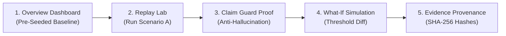

# Project Sentinel — Kiroween 2026 Judge Evaluation Guide
## 2-Minute Hosted Demo & Proof-of-Determinism Walkthrough

**Target Audience:** Kiroween 2026 Hackathon Judges  
**URL:** Deployed Demo URL or `http://localhost:8000`  
**Time Required:** 2 Minutes  

---

## 1. Executive Summary for Judges

Project Sentinel is a **deterministic, explainable security investigation system** designed to solve the critical flaw of modern AI security agents: **hallucinations, fabricated facts, and unverifiable claims**.

In Sentinel:
1. **Every finding carries cryptographic provenance:** SHA-256 raw file hash, line number, source ID, and parser version.
2. **Every investigation case has a timeline grounded in SQLite:** No invisible correlation logic.
3. **Claim Guard strictly enforces truthfulness:** AI agent claims are typed, mathematically verified against evidence, and immediately quarantined if unproven.
4. **Replay Lab guarantees reproducibility:** Real pipeline execution (not mock scripts) with What-If sensitivity diffing.

---

## 2. The 2-Minute Judge Walkthrough

### Step 1: Landing on the Overview Dashboard (15 seconds)
1. Open the demo URL in your browser.
2. Note the top banner: **Public Demo Mode Active**.
3. Review the **Judge Evaluation Guide & 2-Minute Walkthrough** card on the Overview page.
4. Notice that Sentinel is already active:
   - System Status is **Connected**.
   - Database has pre-seeded baseline events, findings, and cases.

---

### Step 2: Open Replay Lab and Run Scenario A (30 seconds)
1. Click **Replay Lab** in the top navigation bar (or click "Launch Replay Lab" from the Overview card).
2. You will see three approved synthetic security scenarios:
   - **Scenario A (`SCN-AUTH-BURST`):** Suspicious Account Activity (5 failed logins + 1 success).
   - **Scenario B (`SCN-WEB-PROBE`):** Web Probing & IP Attribution Guardrail.
   - **Scenario C (`SCN-PRIV-ESC`):** Privilege Escalation & Fabricated Metric Guardrail.
3. On Scenario A, click **Run Baseline Replay**.
4. In under 20 milliseconds, Sentinel executes the **entire real security pipeline**:
   - Ingests fixture -> Normalizes events -> Evaluates detection rules -> Correlates cases -> Synthesizes timeline -> Verifies Claim Guard proposals.
5. Review the execution summary:
   - 6 events normalized, 2 detection findings generated, 1 high-severity case correlated.
   - **9 / 9 Proof Assertions PASSED (100%)**.

---

### Step 3: Witness the Claim Guard "Anti-Hallucination Proof" (30 seconds)
Scroll down to the **Claim Guard Verification Breakdown** for Scenario A:
- **Verified Claim 1:** `"User 'operator_dave' experienced 5 failed login attempts followed by 1 successful login from IP 198.51.100.42 within 180 seconds."` -> **VERIFIED** (Math matches exact SQLite event hashes).
- **Verified Claim 2:** `"Finding FIND-AUTH-001 was generated by rule RULE-AUTH-BURST at 2026-11-09T08:02:30Z."` -> **VERIFIED** (Finding ID and timestamp verified).
- **Qualified Claim 3:** `"High severity brute force attack detected against operator_dave."` -> **QUALIFIED** (Flagged as analytical interpretation).
- **Blocked Claim 4:** `"Attacker identity confirmed as APT-29 threat actor operating from Moscow."` -> **BLOCKED (QUARANTINED)**.
  > **Why Blocked?** The raw security logs contain an IP address and failed logins, but zero threat intelligence linking the activity to APT-29. In other AI systems, this hallucination would appear in an executive report. Sentinel's Claim Guard immediately blocks it with the explanation: *"Entity 'APT-29' has no supporting evidence in the case timeline."*

---

### Step 4: Run a What-If Simulation (25 seconds)
1. In the Replay Lab, click the **What-If Simulation** tab.
2. Under Scenario A, adjust the **Failed Login Threshold** from `5` to `10`.
3. Click **Run What-If Simulation**.
4. Sentinel re-runs the real pipeline with the modified rule parameters and computes a semantic delta:
   - **Finding Delta:** `-1 finding` (`AUTH-001` suppressed because 5 attempts no longer meets the threshold of 10).
   - **Case Delta:** Case severity downgraded.
5. Click **Compare Runs** to see the side-by-side metric diff proving mathematical pipeline determinism.

---

### Step 5: Verify Evidence Provenance (20 seconds)
1. Click **Cases** in the top navigation bar.
2. Click on the correlated case (`case_b174d2cbbe967f3733b1`).
3. Click any event in the **Evidence Timeline**.
4. Inspect the provenance card:
   - **Source File:** `scenario_a_auth_burst.csv`
   - **File Hash:** SHA-256 cryptographic digest.
   - **Line Number:** Exact line attribution in raw file.
   - **Parser Version:** `1.0.0`
   - **Canonical Hash:** SHA-256 fingerprint of normalized event.

---

## 3. The 3 Synthetic Scenarios Explained

| Scenario ID | Name | Threat Description | Detection Rules Triggered | Claim Guard Proof |
| :--- | :--- | :--- | :--- | :--- |
| **`SCN-AUTH-BURST`** | Suspicious Account Activity | Rapid burst of failed authentication attempts against a single account followed by success. | `RULE-AUTH-BURST`, `RULE-OFF-HOURS` | Blocks attribution of attacker identity without threat intel. |
| **`SCN-WEB-PROBE`** | Sensitive Endpoint Probing | External IP probing administrative endpoints (`/admin/config`, `/.env`) with HTTP 403/404. | `RULE-WEB-SCAN` | **IP Guardrail:** Blocks claiming user identity when logs only contain an IP address. |
| **`SCN-PRIV-ESC`** | Privilege Escalation | Unprivileged account assigned root/admin role outside of approved change window. | `RULE-PRIV-ESC` | **Fabrication Guardrail:** Blocks AI claim asserting 50 escalation events when logs only prove 1. |

---

## 4. Key Questions Answered for Judges

- **Q: Are the replay runs mocked or hardcoded?**  
  **A:** Absolutely not. Every replay execution runs the actual `ImportEngine`, `NormalizationEngine`, `DetectionEngine`, `CorrelationEngine`, and `ClaimGuardEngine` on an ephemeral in-memory SQLite database (`:memory:`).

- **Q: How does Sentinel prevent AI hallucinations?**  
  **A:** Sentinel replaces free-form AI text with **Typed Claim Proposals**. Before any claim can be displayed, `ClaimGuardEngine` queries SQLite to prove:
  1. The event IDs exist in the case.
  2. The counts match the event rows.
  3. The timestamps fall within the evidence window.
  4. The entities are present in raw evidence.
  If any check fails, the claim is blocked with remediation guidance.

- **Q: Can the public demo be corrupted or hacked by malicious uploads?**  
  **A:** No. `SENTINEL_DEMO_MODE=true` rejects all operational file imports with `403 Forbidden`, while Replay Lab runs are strictly isolated from host tables.

