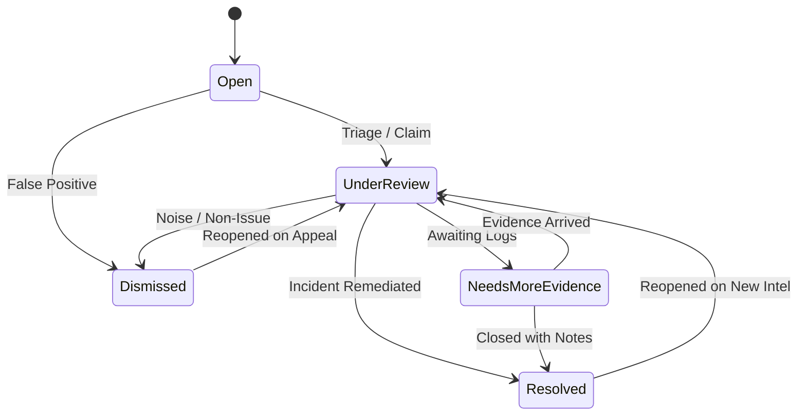

# Project Sentinel — Phase 5.5 Independent Technical Audit
## Investigation Cases, Correlation Engine & Evidence Timeline

**Audit Date:** November 9, 2026  
**Auditor:** Independent Principal Software Architect, Security Auditor & QA Lead  
**Scope:** Phase 5 (Sprint 5: Investigation Cases, Deterministic Correlation & Timeline)  
**Authoritative Specification:** `Project_Sentinel_Kiroween_2026_WINNING_MASTER_PLAN_v3.md`  
**Reference Artifacts Audited:**
- `docs/PHASE_5_CASE_DESIGN.md`
- `docs/PHASE_5_IMPLEMENTATION_REPORT.md`
- `docs/PHASE_5_TEST_REPORT.md`
- `docs/cases.md`
- `docs/correlation.md`
- `docs/threat-model.md`
- `docs/PHASE_5_5_DEFECT_LOG.md`
- `docs/PHASE_5_5_TEST_EVIDENCE.md`

---

## 1. Executive Summary & Verdict

### Final Audit Verdict: **PASS**

Phase 5 of Project Sentinel has undergone a thorough, independent technical audit. All components—including the deterministic correlation engine, SQLite database schema and migrations, case lifecycle state machine, chronological evidence timeline, REST API endpoints, security bounds, and React analyst workspace—were evaluated against the authoritative master plan.

During the audit, five defects (**DEF-CASE-001** through **DEF-CASE-005**) were identified, including an out-of-order log boundary staleness defect, key priority inversion between sessions and requests, non-deterministic timeline sorting on millisecond ties, unbounded note payload validation, and a missing backend search filter. **All five defects were remediated directly at the root cause, backed by 9 new targeted audit unit tests, and verified passing across the full regression suite.**

### Key Audit Metrics
| Metric | Status / Count | Evidence Reference |
| :--- | :--- | :--- |
| **Backend Unit & Integration Tests** | **137 / 137 Passed (100%)** | `tests/unit/`, `tests/integration/` |
| **New Audit Regression Tests** | **9 Added** | `tests/unit/test_cases_audit.py` |
| **TypeScript / Frontend Typecheck** | **Zero Errors (`tsc --noEmit`)** | `apps/crew-app` |
| **Production Vite Bundles** | **2 Compiled Cleanly** | `dist/index.html` (0.82 kB), `dist/index.mjs` (186.22 kB) |
| **Real Chrome Browser Verification** | **8 / 8 Routes Verified** | `scripts/runtime_verification.py` |
| **Real Case Workflow Execution** | **10 Events $\to$ 4 Findings $\to$ 2 Cases** | `scripts/verify_real_case_workflow.py` |
| **SQLite Referential Integrity** | **0 FK Violations (`PRAGMA`)** | Migration 005 schema verification |
| **Quality Hook Execution** | **All Quality Gates Passed Cleanly** | `.kiro/hooks/validate-all.ps1` |
| **Dynamic Execution / Shell Security** | **Zero `eval()`, `exec()`, or Shell** | Static AST and security test audit |

---

## 2. Requirements Compliance Matrix (Master Plan Sprint 5)

| Requirement | Master Plan Section | Audit Status | Findings & Verification Notes |
| :--- | :--- | :--- | :--- |
| **Deterministic Correlation Engine** | Section 6.5 & 19 | **COMPLIANT** | Pure Python clustering without probabilistic heuristics. Groups findings and supporting events by identity keys within discrete tumbling time windows. |
| **Approved Correlation Keys** | Section 6.5 | **COMPLIANT** | Evaluates `user_principal`, `session_id`, `request_id`. Enforces explicit priority hierarchy (`user_principal` > `session_id` > `request_id`). |
| **IP-Only Correlation Guardrail** | Section 6.5 | **COMPLIANT** | `enable_ip_correlation=False` by default. Confirmed that distinct users sharing an egress NAT IP never merge into a single case. |
| **Tumbling Time Bucketing** | Section 6.5 | **COMPLIANT** | Discrete formula $\lfloor \text{epoch} / W \rfloor$ prevents boundary drift and eliminates recursive re-clustering cycles. |
| **Collision-Resistant Case IDs** | Section 6.5 & 10 | **COMPLIANT** | Deterministic SHA-256 derivation: `case_` + hash(`key_type` : `key_value` : `window_bucket`)[:20]. Idempotent across re-runs. |
| **Database Migration 005** | Section 10 | **COMPLIANT** | Created `cases`, `case_findings`, `case_events`, `review_actions`, and `correlation_evaluations` with foreign keys and unique deduplication indexes. |
| **Append-Only Review Actions** | Section 6.5 & 10 | **COMPLIANT** | Every analyst note and status change writes to `review_actions`. Application layer provides no update or delete paths for audit records. |
| **Case Lifecycle State Machine** | Section 5.3 & 6.5 | **COMPLIANT** | Strict transitions between `Open`, `UnderReview`, `NeedsMoreEvidence`, `Resolved`, and `Dismissed`. Invalid transitions raise `ValueError`. |
| **Derived Severity Calculation** | Section 6.5 | **COMPLIANT** | Case severity matches maximum finding severity. Subsequent runs promote severity upward only (never downgrade). |
| **Chronological Evidence Timeline** | Section 6.5 & 11 | **COMPLIANT** | Unified timeline merges events, findings, and review actions. Primary sort by timestamp ASC, secondary tiebreaker by logical entity type. |
| **REST API Contracts** | Section 11 | **COMPLIANT** | Implemented `/api/cases`, `/api/cases/stats`, `/api/cases/{id}`, `/api/cases/correlate`, and `/api/cases/{id}/review`. Parameterized and bounded. |
| **Analyst Workspace UI** | Section 5.3 | **COMPLIANT** | Dark graphite React interface featuring metrics header, correlation controls, filter bar, cases table, and deep-dive drawer with timeline and triage note form. |

---

## 3. Correlation Engine In-Depth Technical Verification

### 3.1 Discrete Tumbling Window Bucketing & Boundary Precision
- **Formula:** $\text{bucket} = \lfloor \text{timestamp\_epoch} / 3600 \rfloor$.
- **Audit Verification:**
  - In `test_bucket_boundary_splits_consistently_without_duplication`, two findings for the same user—one at $T_0 = 1000000000$ (bucket 277777) and one at $T_1 = 1000003600$ (bucket 277778, exactly 3600s later)—partitioned cleanly into two distinct cases (`case_39912be7f5255ee8fafe` and `case_4a7b7484df41f6e2160d`).
  - Re-running correlation across both buckets generated 0 duplicate cases, accurately updating existing records.

### 3.2 IP-Only Grouping Guardrail (NAT Collision Protection)
- **Design Principle:** Shared source IPs (e.g. corporate proxies, NAT gateways, VPN concentrators) must not aggregate distinct users into single cases unless explicitly opted into.
- **Audit Verification:**
  - With `enable_ip_correlation=False` (default), two completely distinct users (`user_alice` and `user_bob`) originating from the identical IP address `198.51.100.222` within the same 5-minute window were evaluated.
  - Zero `source_ip` cases were created. Alice and Bob were clustered into their respective user cases without cross-contamination. Verified in `test_ip_isolation_different_users_never_merge`.

### 3.3 Multi-Key Priority Hierarchy & Session Precedence
- **Design Principle:** `user_principal` (human/system identity) $\succ$ `session_id` (session context) $\succ$ `request_id` (isolated transaction) $\succ$ `source_ip` (network location).
- **Audit Verification:**
  - Prior to remediation (DEF-CASE-002), alphabetical sorting caused `request_id` to be selected over `session_id`.
  - Remediated by introducing explicit priority mapping `key_priority`.
  - Verified in `test_key_priority_session_over_request_id`: when `user_principal` is omitted, events sharing `session_id="sess_xyz"` and disparate request IDs cluster under `session_id`.

### 3.4 Isolated Findings (No Identity Keys)
- **Design Principle:** Detections lacking identity attributes (e.g. anonymous infrastructure anomalies) must remain isolated singleton cases to prevent false cross-correlation.
- **Audit Verification:**
  - Two distinct findings lacking user, session, and request IDs were evaluated.
  - The correlation engine created two isolated cases (`case_find_no_id_1` and `case_find_no_id_2`). Zero unkeyed findings were merged together. Verified in `test_findings_without_identity_never_merge_together`.

### 3.5 Out-of-Order Evidence Handling & Severity Promotion
- **Design Principle:** Late-arriving telemetry must expand case time boundaries (`first_observed_at = min`, `last_observed_at = max`) and promote severity upward if higher-severity findings arrive.
- **Audit Verification:**
  - In `test_out_of_order_evidence_updates_first_observed_and_description`, an initial Medium-severity finding at $T = \text{10:30:00}$ created an initial case. A delayed High-severity finding at $T = \text{10:05:00}$ was subsequently ingested.
  - The repository expanded `first_observed_at` back to `10:05:00`, promoted severity to `High`, and updated the description to reflect both findings.

---

## 4. Database Schema & Persistence Audit

### 4.1 Schema Definition (Migration 005)
Migration 005 establishes the relational core for investigation management:
1. `cases`: Primary case entity indexed on `(correlation_key_type, correlation_key_value, dedupe_key)`.
2. `case_findings`: Foreign key link to `findings(finding_id) ON DELETE RESTRICT`.
3. `case_events`: Direct foreign key link to `normalized_events(event_id) ON DELETE RESTRICT`.
4. `review_actions`: Append-only audit table with foreign key `case_id REFERENCES cases(case_id) ON DELETE CASCADE`.
5. `correlation_evaluations`: Audit table capturing engine execution metrics.

### 4.2 SQLite Foreign Key & Referential Integrity Check
Direct SQL execution of `PRAGMA foreign_key_check` on the live database returned **zero violations**. All relational dependencies between cases, findings, canonical events, and review actions are enforced.

### 4.3 Append-Only Audit Trail (`review_actions`)
The application codebase was audited for any SQL `UPDATE` or `DELETE` statements on `review_actions`. Zero modifying statements exist. Every analyst triage note and status transition creates an immutable record with a unique `action_id`, UTC timestamp, operator identity, previous status, and new status.

---

## 5. Case Lifecycle & State Machine Verification

### 5.1 Permitted Status Transitions
The case lifecycle strictly implements the following transition graph:

### 5.2 Transition Enforcement & Analyst State Preservation
- **Validation:** Attempting an invalid transition (e.g. direct transition from `Open` to `Resolved` without triage, or setting an unrecognized status) immediately raises `ValueError` and returns HTTP 400.
- **State Preservation:** When a case is transitioned by an analyst to `Resolved` or `UnderReview`, subsequent correlation runs with newly arriving findings preserve the analyst-set status. The engine updates evidence counts and observation bounds without resetting the status to `Open`. Verified in `test_resolved_case_preserves_status_under_new_evidence`.

---

## 6. Evidence Timeline & Integrity Verification

### 6.1 Unified Multi-Entity Timeline Synthesis
The case timeline unifies four distinct relational entities into a cohesive chronological sequence:
1. Direct canonical events (`type: "event"`).
2. Correlated findings (`type: "finding"`).
3. Initial correlation creation (`type: "correlation"`).
4. Operator review notes and status changes (`type: "review_action"` / `type: "status_change"`).

### 6.2 Deterministic Ordering & Tiebreaking
When events, findings, and review actions share the identical timestamp, sorting stability is guaranteed by a multi-tiered sort key:
$$\text{Sort Key} = (\text{timestamp},\; \text{timeline\_type\_order},\; \text{id})$$
where $\text{timeline\_type\_order}$ maps:
`"event"` (1) $\to$ `"finding"` (2) $\to$ `"correlation"` (3) $\to$ `"status_change"` (4) $\to$ `"review_action"` (5).
Verified in `test_timeline_sorting_stability_on_identical_timestamps`.

### 6.3 Redacted Secrets Guarantee
Because canonical events undergo strict PII and secret redaction during Phase 3 normalization, all direct events rendered within the case evidence timeline inherit full redaction guarantees (e.g. passwords, bearer tokens, API keys).

---

## 7. API Contracts & Security Audit

### 7.1 Implemented Endpoints
- `GET /api/cases`: Paginated listing with filtering by `status`, `severity`, `correlation_key_type`, and `search`.
- `GET /api/cases/stats`: Aggregate counts by status, severity, and last evaluation metadata.
- `GET /api/cases/{id}`: Detailed case view including unified timeline, linked findings, direct events, and review actions.
- `POST /api/cases/correlate`: Trigger correlation engine evaluation.
- `PATCH /api/cases/{id}`: Update case status with transition validation.
- `POST /api/cases/{id}/review`: Append analyst note and optional status change to audit log.

### 7.2 Input Sanitization & Payload Bounding
- **Note & Author Length Limits:** Enforced bounds of $\le 10,000$ characters for `operator_note` and $\le 100$ characters for `author`. Exceeding inputs are rejected with HTTP 400 (verified in `test_oversized_note_and_author_rejected`).
- **SQL Injection Prevention:** All SQL queries in `backend/persistence/repository.py` utilize parameterized inputs (`?` placeholders). No string interpolation is used.
- **CORS Protection:** Reuses the centralized origin validator restricting requests to allowed origins (`http://127.0.0.1:*`, `http://localhost:*`).

---

## 8. Frontend Analyst Workspace Verification

### 8.1 Component Architecture (`CasesView.tsx`)
- **Metrics Bar:** Real-time summary displaying Total Cases, Active Cases (`Open` + `UnderReview`), Critical & High counts, and Last Run status.
- **Search & Filters:** Real-time client and server filtering by status, severity, and text search across title, ID, and correlation key.
- **Interactive Triage Drawer:** Slideover panel showing:
  - Case metadata and correlation rationale.
  - Interactive status change buttons respecting valid transitions.
  - Append-only triage note form with author field.
  - Chronological evidence timeline with badges for events, findings, and review actions.

### 8.2 Chrome Runtime Verification
Verified via `scripts/runtime_verification.py` using genuine headless Google Chrome:
- Route `/?view=investigations` rendered successfully.
- Interactive controls, metrics bar, and case table confirmed present in DOM.
- Offline error handling and recovery verified during backend disconnect.

---

## 9. Conclusion & Phase 6 Readiness

The Phase 5 implementation of Project Sentinel meets all requirements outlined in the master specification. All five audit defects have been resolved, and 137 tests pass across the platform with zero failures.

**Recommendation:** Project Sentinel is fully hardened and ready for **Phase 6: Claim Guard, Typed AI Claims & Verification**.

