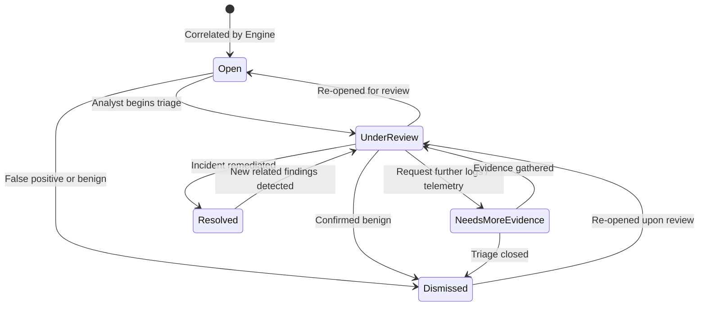

# Project Sentinel — Phase 5 Case Architecture & Correlation Design Specification
**Document Version:** 1.0.0  
**Status:** Approved for Implementation  
**Sprint:** Sprint 5 (Investigation Cases, Deterministic Correlation & Timeline)  

---

## 1. Executive Summary & Purpose

Phase 2 established secure ingestion, format detection, and SQLite persistence.  
Phase 3 established deterministic canonical event normalization, timezone enforcement, and provenance tracking.  
Phase 4 established deterministic detection rules and evidence-backed findings.  

Phase 5 introduces **Investigation Cases & Deterministic Correlation**:
An explainable, deterministic grouping engine that correlates related security findings and canonical events into unified investigation cases conforming to the master plan specification (`Project_Sentinel_Kiroween_2026_WINNING_MASTER_PLAN_v3.md`, Sections 5.3, 6.5, 10, 11, 19).

### Architectural Principles:
1. **Strict Determinism:** Case clustering is a pure function over findings and canonical events within bounded observation windows (default 3600 seconds). Given identical findings and events, the engine creates the exact same cases and evidence links.
2. **Zero Heuristics / Zero Machine Learning:** No probabilistic clustering, fuzzy matching, or generative AI models are used to group findings or invent cases. Every correlation is anchored to an approved explicit identity key.
3. **No IP-Only Identity Grouping (Mandatory Guardrail):** Source IP addresses are ephemeral network locations (NAT, proxies, DHCP, shared networks) and are **never** treated as human or system identities by default (`enable_ip_correlation = False`). Correlation keys must be explicit normalized identifiers: `user_principal`, `session_id`, or `request_id`.
4. **Collision-Resistant Case Identity:** Case identifiers (`case_id`) are derived deterministically via SHA-256 over `(correlation_key_type, correlation_key_value, window_bucket)`. Repeated engine runs never produce duplicate cases.
5. **Idempotency & Analyst State Preservation:** Re-running correlation updates observation boundaries and derives higher severity if new evidence emerges, but **strictly preserves** analyst case status (`Open`, `UnderReview`, `Resolved`, etc.) and preserves all append-only operator notes.
6. **Unified Chronological Evidence Timeline:** Each case reconstructs an end-to-end evidence trail interleaving canonical raw events, triggered detection findings, correlation rationale, and operator review actions in strict UTC chronological order.
7. **Strict State Machine Transitions:** Case status transitions (`Open`, `UnderReview`, `NeedsMoreEvidence`, `Resolved`, `Dismissed`) are strictly validated against an allowed transition graph. Every transition and operator note is recorded as an immutable, append-only review action.

---

## 2. Approved Correlation Keys & Data Model

### 2.1 Approved Identity Keys
Findings and supporting canonical events are evaluated for explicit keys in strict priority order:
1. **`user_principal`**: The normalized user identity (e.g. `analyst_bob`, `victim_user`).
2. **`session_id`**: An explicit session identifier from event attributes (e.g. `sess_12345`).
3. **`request_id` / `trace_id`**: An explicit transaction or HTTP request trace identifier.
4. **`source_ip`**: Contextual network evidence only. Grouping on source IP is **disabled by default** to avoid false grouping across NAT gateways and shared IP pools.

### 2.2 Case Identity Derivation
```python
def compute_case_id(key_type: str, key_value: str, window_bucket: int) -> str:
    raw = f"{key_type}:{key_value}:{window_bucket}"
    digest = hashlib.sha256(raw.encode("utf-8")).hexdigest()[:20]
    return f"case_{digest}"
```
Where `window_bucket = int(epoch // window_seconds)`.

### 2.3 Derived Severity State Machine
Case severity is derived transparently as the highest severity among all linked findings:
$$\text{Severity}(\text{Case}) = \max_{f \in \text{Findings}} \text{Severity}(f)$$

Severity hierarchy:
$$\text{Critical (5)} > \text{High (4)} > \text{Medium (3)} > \text{Low (2)} > \text{Info (1)}$$

---

## 3. SQLite Schema Design (Migration 005)

### 3.1 `cases` Table
Stores root investigation case entities:
```sql
CREATE TABLE IF NOT EXISTS cases (
    case_id TEXT PRIMARY KEY,
    title TEXT NOT NULL,
    description TEXT NOT NULL,
    status TEXT NOT NULL DEFAULT 'Open',
    severity TEXT NOT NULL DEFAULT 'Medium',
    correlation_key_type TEXT NOT NULL,
    correlation_key_value TEXT NOT NULL,
    first_observed_at TEXT NOT NULL,
    last_observed_at TEXT NOT NULL,
    algorithm_version TEXT NOT NULL,
    dedupe_key TEXT NOT NULL,
    metadata_json TEXT NOT NULL DEFAULT '{}',
    created_at TEXT NOT NULL,
    updated_at TEXT NOT NULL,
    CONSTRAINT chk_case_status CHECK (status IN ('Open', 'UnderReview', 'NeedsMoreEvidence', 'Resolved', 'Dismissed')),
    CONSTRAINT chk_case_severity CHECK (severity IN ('Critical', 'High', 'Medium', 'Low', 'Info')),
    CONSTRAINT uq_case_dedupe UNIQUE (correlation_key_type, correlation_key_value, dedupe_key)
);
```

### 3.2 Junction Tables (`case_findings` and `case_events`)
Provide direct foreign-key relationship links between cases, findings, and canonical events:
```sql
CREATE TABLE IF NOT EXISTS case_findings (
    case_id TEXT NOT NULL,
    finding_id TEXT NOT NULL,
    correlation_rationale TEXT NOT NULL,
    created_at TEXT NOT NULL,
    PRIMARY KEY (case_id, finding_id),
    FOREIGN KEY (case_id) REFERENCES cases(case_id) ON DELETE CASCADE,
    FOREIGN KEY (finding_id) REFERENCES findings(finding_id) ON DELETE CASCADE
);

CREATE TABLE IF NOT EXISTS case_events (
    case_id TEXT NOT NULL,
    event_id TEXT NOT NULL,
    relationship_type TEXT NOT NULL DEFAULT 'supporting_evidence',
    correlation_rationale TEXT NOT NULL,
    created_at TEXT NOT NULL,
    PRIMARY KEY (case_id, event_id),
    FOREIGN KEY (case_id) REFERENCES cases(case_id) ON DELETE CASCADE,
    FOREIGN KEY (event_id) REFERENCES normalized_events(event_id) ON DELETE CASCADE
);
```

### 3.3 `review_actions` Table
Append-only immutable audit trail of operator notes, triage assessments, and status updates:
```sql
CREATE TABLE IF NOT EXISTS review_actions (
    action_id TEXT PRIMARY KEY,
    case_id TEXT NOT NULL,
    action_type TEXT NOT NULL,
    previous_status TEXT,
    new_status TEXT,
    operator_note TEXT NOT NULL,
    author TEXT NOT NULL DEFAULT 'secops_operator',
    created_at TEXT NOT NULL,
    FOREIGN KEY (case_id) REFERENCES cases(case_id) ON DELETE CASCADE
);
```

### 3.4 `correlation_evaluations` Table
Tracks correlation engine execution performance, scan counts, and latency:
```sql
CREATE TABLE IF NOT EXISTS correlation_evaluations (
    evaluation_id TEXT PRIMARY KEY,
    evaluated_at TEXT NOT NULL,
    findings_scanned INTEGER NOT NULL,
    events_scanned INTEGER NOT NULL,
    cases_created INTEGER NOT NULL,
    cases_updated INTEGER NOT NULL,
    duration_ms REAL NOT NULL
);
```

---

## 4. State Transition Machine

Permitted case lifecycle state transitions:



Attempting an unpermitted transition (e.g. `Open` $\rightarrow$ `Resolved` directly without `UnderReview`) raises an immediate validation error.

---

## 5. API Contracts

### 5.1 Endpoints
- `GET /api/cases`: Paginated list of cases with filters (`status`, `severity`, `correlation_key_type`, `search`) and summary evidence counts (`finding_count`, `event_count`, `review_count`).
- `GET /api/cases/stats`: Aggregate counts by status and severity, plus latest correlation evaluation run metrics.
- `GET /api/cases/{case_id}`: Comprehensive case detail containing all linked findings, all canonical supporting events with file/line provenance, the assembled chronological evidence timeline, and all review actions.
- `POST /api/cases/correlate`: Triggers deterministic correlation engine with optional `window_seconds` and `limit_findings`.
- `POST /api/cases/{case_id}/review`: Appends an immutable operator note and/or executes an authorized status change.
- `PATCH /api/cases/{case_id}`: Direct status update validating the allowed state machine.

---

## 6. Frontend Architecture (`CasesView.tsx`)

The frontend delivers a high-density, accessible dark graphite workspace for SecOps analysts:
1. **Metrics Header**: Real-time counter badges for `Open`, `UnderReview`, `NeedsMoreEvidence`, `Resolved`, and `Dismissed`.
2. **Engine Trigger**: Direct "Run Correlation Engine" button with progress spinner and execution feedback.
3. **Filter Controls**: Multi-attribute filtering by Status, Severity, and free-text search across Title and Identity Keys.
4. **Cases Data Table**: Displays derived severity badge, title, identity key type and value, observation window, status badge, evidence counts, and "Investigate" action.
5. **Interactive Detail Drawer**:
   - Header with derived severity explanation.
   - Status selector with operator note input and review history button.
   - Correlation rationale panel with explicit explanation of identity rules and time window.
   - Chronological evidence timeline distinguishing events, findings, correlation, review actions, and status changes.
   - Sub-modals for inspecting finding conditions and canonical event provenance.

