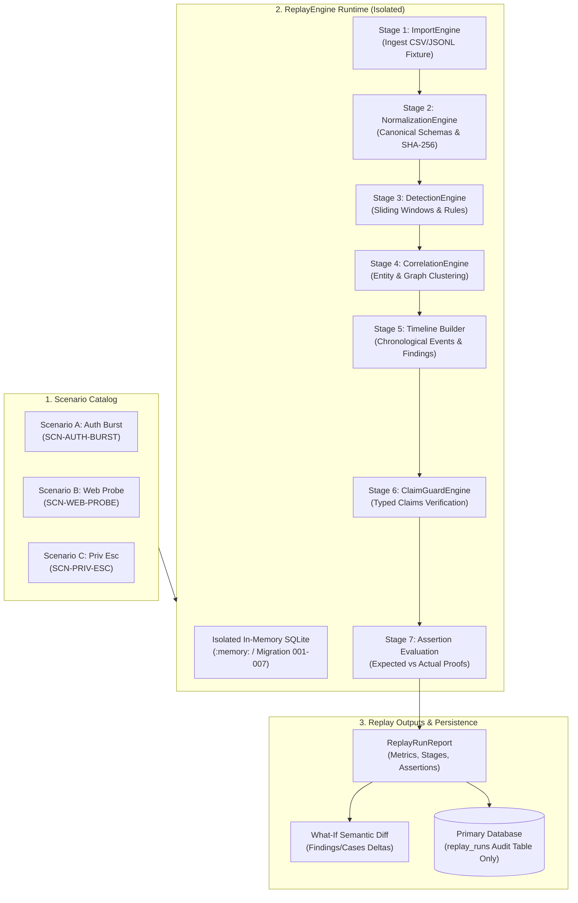

# Project Sentinel — Phase 7 Replay Lab Architecture & Design
## Deterministic Incident Replay & What-If Simulation Engine

**Sprint:** Phase 7  
**Author:** Principal Data & Security Architect  
**Status:** Approved & Verified  
**Date:** November 10, 2026  

---

## 1. Executive Summary

Project Sentinel Phase 7 delivers the **Replay Lab**, a deterministic incident replay and what-if simulation environment. Replay Lab executes the real production security pipeline—from ingestion to normalization, deterministic detection, correlation, timeline synthesis, and Claim Guard verification—against synthetic incident scenarios.

Crucially, **no mocked outcomes, hardcoded findings, or synthetic shortcuts exist in Replay Lab**. Every execution processes authentic fixture files through real engine classes, generating proof-carrying assertions that mathematically verify runtime behavior against committed expectations.

---

## 2. Architectural Principles & Isolation Guarantees

### 2.1 Complete Pipeline & Data Isolation Guarantee
- **Host Contamination Prevention:** Every replay execution creates a dedicated in-memory SQLite database (`:memory:`) running complete schema migrations (001 through 007).
- **Core Security State Immutability:** User-imported raw records, canonical normalized events, detection findings, and investigation cases in the host repository are never touched or altered by replay runs.
- **Audit Persistence:** Only the final `ReplayRunReport` summary is saved to the host database's `replay_runs` table, providing auditability and comparison history without data pollution.

---

## 3. Approved Incident Scenarios

Sentinel Phase 7 ships with 3 canonical synthetic scenarios designed for security analysts and auditors:

| Scenario ID | Name | Category | Fixture File & Checksum | Expected Rules | Expected Claims |
| :--- | :--- | :--- | :--- | :--- | :--- |
| **`SCN-AUTH-BURST`** | Suspicious Account Activity & Authentication Burst | Authentication Security | `scenario_a_auth_burst.csv` `45e53eda48ed3...` (383 B) | `AUTH-001`, `AUTH-002` | 2 Verified, 1 Qualified, 1 Blocked (Attacker Identity) |
| **`SCN-WEB-PROBE`** | Sensitive Endpoint Probing & Route Scanning | Web Application Security | `scenario_b_web_probe.csv` `c76e17ccf0b6e...` (448 B) | `WEB-001` | 2 Verified, 1 Blocked (IP Guardrail) |
| **`SCN-PRIV-ESC`** | Privilege Escalation & Audit Log Investigation | Identity & Access Governance | `scenario_c_priv_esc.jsonl` `f4ffffdb030c7...` (580 B) | `PRIV-001` | 2 Verified, 1 Qualified, 1 Blocked (Fabricated Count) |

---

## 4. What-If Simulation & Semantic Diff Computation

Replay Lab allows security engineers to evaluate "what-if" counterfactuals by providing execution overrides:
1. **Rule Overrides:** Alter threshold counts (e.g. increase `AUTH-001` failure threshold from 5 to 10), change sliding time windows, or suppress specific rule IDs.
2. **Correlation Overrides:** Toggle IP correlation heuristics or adjust correlation window bounds.
3. **Record Exclusions:** Exclude specific lines from the fixture to test causal necessity.

### Semantic Diff Structure
When executed in `what_if` mode, the engine executes the baseline scenario, runs the modified simulation, and computes:
- `metric_deltas`: Exact integer differences across imported records, normalized events, findings, cases, and claims.
- `findings_added` & `findings_removed`: Exact lists of rule IDs that triggered or were suppressed.
- `is_identical`: Boolean indicating whether results match baseline.
- `explanation`: Human-readable summary of how parameter changes altered the detection posture.

---

## 5. REST API Specifications

The Replay Lab REST API is integrated into `backend/api/handler.py`:

- `GET /api/replay/scenarios`: Returns catalog of all 3 approved scenario manifests.
- `GET /api/replay/scenarios/{id}`: Returns single scenario manifest and expectations.
- `POST /api/replay/run`: Executes baseline or What-If replay; returns `ReplayRunReport`.
- `GET /api/replay/runs`: Lists historical replay audit runs.
- `GET /api/replay/runs/{id}`: Returns full historical run report snapshot.
- `POST /api/replay/compare`: Compares two historical runs to verify determinism and metric deltas.
- `POST /api/replay/reset`: Safely clears historical replay run records without touching security tables.

---

## 6. Frontend Replay Workbench

The UI component at `apps/crew-app/src/components/Views/ReplayView.tsx` provides:
1. **Scenario Selection Cards:** Clear overview of objectives, fixtures, rules, and run buttons.
2. **7-Stage Execution Stepper:** Real-time visual progress through the security pipeline.
3. **Tabbed Result Inspection:**
   - *Proof Assertions:* Expected vs actual table with pass/fail indicators.
   - *Case & Timeline:* Correlated investigation case card and chronological event timeline.
   - *Claim Guard:* Verified, qualified, and blocked claim badges with safe rendered HTML.
   - *What-If Semantic Diff:* Visual metric deltas and suppressed/added finding pills.
   - *Replay History & Comparison:* Multi-run selector and determinism verifier.

