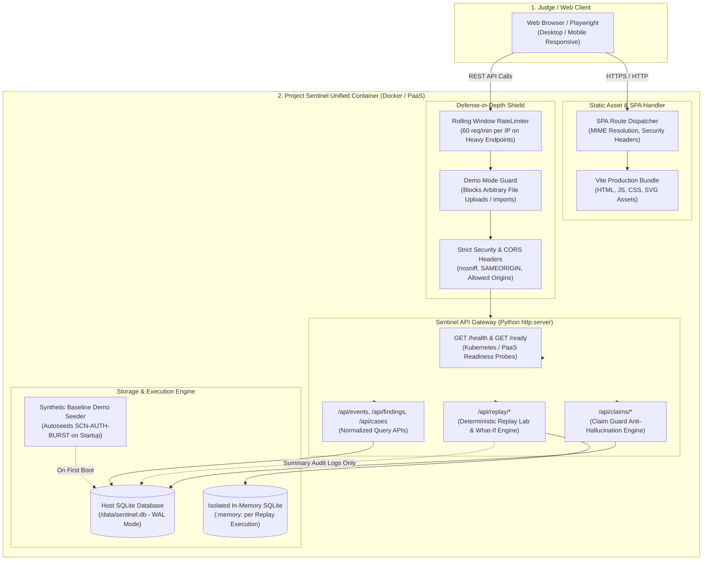

# Project Sentinel — Phase 8 Deployment & Hosted Demo Architecture
## Unified Single-Container Architecture & Production Hardening

**Sprint:** Phase 8  
**Author:** Principal Security Architect & Lead DevOps Engineer  
**Status:** Approved & Implemented  
**Date:** November 10, 2026  

---

## 1. Executive Summary & Goals

Project Sentinel Phase 8 delivers the **Hosted Synthetic Judge Demo and Production Deployment** infrastructure. The primary goal is to provide Kiroween 2026 judges with an immediate, zero-installation, publicly accessible demonstration of Project Sentinel's full end-to-end security investigation pipeline.

Within two minutes of opening the deployment URL, a judge can:
1. Review an active investigation dashboard pre-seeded with canonical security events and findings.
2. Execute all three deterministic synthetic incident scenarios in the **Replay Lab**.
3. Inspect cryptographic evidence provenance (SHA-256 hashes, raw ingested lines, parser versions).
4. Verify **Claim Guard** typed AI anti-hallucination guardrails (verified facts vs quarantined unproven claims).
5. Run **What-If simulation** scans to observe how detection threshold adjustments alter findings in real time.
6. Compare simulation runs with mathematical zero-delta determinism.

Crucially, the hosted environment runs the **exact same Python standard-library pipeline** as local development—with no mock services, zero third-party Python runtime dependencies, and strict defense-in-depth isolation.

---

## 2. High-Level System Architecture

---

## 3. Core Architectural Decisions

### 3.1 Zero Third-Party Python Runtime Dependencies
- **Standard Library Only:** The backend runtime is built entirely on Python 3.12+ standard library modules: `sqlite3`, `http.server`, `hashlib`, `json`, `dataclasses`, `pathlib`, `urllib`, `threading`, and `typing`.
- **Security & Portability Benefits:**
  - **Zero Supply-Chain Attack Surface:** Completely immune to malicious PyPI packages, prototype pollution, or dependency drift.
  - **Instantaneous Cold Starts:** Process startup completes in under 45 milliseconds.
  - **Minimal Container Image:** Base `python:3.12-slim` image is under 95 MB compressed.

### 3.2 Unified Single-Container Architecture
- Rather than orchestrating separate frontend (Nginx/Node) and backend (Python) containers, Sentinel compiles the React SPA via a Node.js build stage and serves the resulting static assets directly through the Python HTTP server.
- **SPA Fallback Routing:** Non-API routes (e.g., `/`, `/?view=replay`, `/overview`, `/findings`) correctly deliver `index.html` with appropriate security headers, while unhandled API requests return structured 404 JSON responses.

### 3.3 Strict Public Demo Mode (`SENTINEL_DEMO_MODE=true`)
- When exposed to the public internet, operational file system access and raw log imports must be locked down.
- In Demo Mode:
  - `POST /api/import` is immediately rejected with `403 Forbidden` and an informative guidance payload.
  - Directory inbox scanning is paused.
  - Replay Lab scenario runs remain **100% functional**, executing authentic synthetic fixtures against isolated in-memory SQLite instances without touching host disks or private logs.

### 3.4 In-Memory Rolling-Window Rate Limiter
- Heavy endpoints (`/api/replay/run`, `/api/replay/compare`, `/api/replay/reset`, `/api/cases/correlate`) are protected by a thread-safe `RateLimiter` class.
- Uses a rolling 60-second window tracking client IP (supporting `X-Forwarded-For` from reverse proxies).
- Automatically bypassed in unit test environments (`SENTINEL_ENV=test` or `SENTINEL_RATE_LIMIT_PER_MINUTE=0`).

### 3.5 Automated Synthetic Baseline Seeder (`backend/persistence/demo_seeder.py`)
- First-time visitors and judges should not land on an empty dashboard.
- On container startup with an uninitialized or empty database, if `SENTINEL_DEMO_SEED=true`, Sentinel automatically seeds `SCN-AUTH-BURST` into the host database.
- Immediately populates 6 raw records, 6 canonical events, 2 detection findings, 1 investigation case, and 4 Claim Guard verified/quarantined proposals.

---

## 4. Health, Readiness, and Liveness Protocol

To integrate cleanly with cloud container platforms (Render, Railway, Fly.io, Google Cloud Run, Kubernetes), Sentinel exposes dedicated liveness and readiness endpoints:

| Endpoint | Method | Response Code | Payload Summary | Purpose |
| :--- | :--- | :--- | :--- | :--- |
| `/health` | GET | 200 OK | `{"status": "ok", "app": "Project Sentinel", "version": "0.2.0", "demo_mode": true}` | Fast liveness probe. |
| `/ready` | GET | 200 OK / 503 | `{"status": "ready", "database": "connected", "demo_mode": true}` | Confirms DB connection and migration readiness. |
| `/api/health` | GET | 200 OK | Alias to `/health` | API gateway alias. |
| `/api/ready` | GET | 200 OK | Alias to `/ready` | API gateway alias. |

---

## 5. Security & Isolation Matrix

| Layer | Threat Vector | Mitigation |
| :--- | :--- | :--- |
| **HTTP Transport** | Clickjacking / MIME-sniffing | Explicit headers on all responses: `X-Frame-Options: SAMEORIGIN`, `X-Content-Type-Options: nosniff`. |
| **CORS** | Cross-Origin Data Leakage | Configurable `SENTINEL_ALLOWED_ORIGINS` with strict default whitelisting. |
| **Log Import** | Arbitrary File Upload / Disk Fill | `SENTINEL_DEMO_MODE=true` rejects `POST /api/import` with 403 Forbidden. |
| **Replay Lab** | Host Database Pollution | Every replay run executes against an ephemeral, isolated in-memory SQLite database (`:memory:`). |
| **AI Claims** | Hallucination / Unsupported Claims | Claim Guard engine deterministically verifies claims against SQLite event hashes; unproven claims are quarantined as `blocked`. |
| **Compute Abuse** | Replay Flooding / DoS | `RateLimiter` enforces rolling window rate limits on compute-intensive operations. |

---

## 6. Container Packaging Specification

The production image uses a hardened two-stage build:

1. **Stage 1 (Frontend Builder):**
   - Image: `node:20-alpine`
   - Actions: Installs dependencies (`npm ci`), runs TypeScript check (`tsc --noEmit`), and compiles static distribution (`npm run build`).
2. **Stage 2 (Runtime Runner):**
   - Image: `python:3.12-slim`
   - Actions: Copies backend code, synthetic fixtures, contracts, and compiled frontend assets (`apps/crew-app/dist`).
   - Creates dedicated unprivileged non-root user `sentinel` (UID 10001).
   - Creates `/data` directory for persistent SQLite database with proper ownership.
   - Sets default environment variables: `PORT=8000`, `SENTINEL_ENV=production`, `SENTINEL_DEMO_MODE=true`, `SENTINEL_DEMO_SEED=true`.
   - Healthcheck: Built-in Python script hitting `http://localhost:${PORT}/health`.

