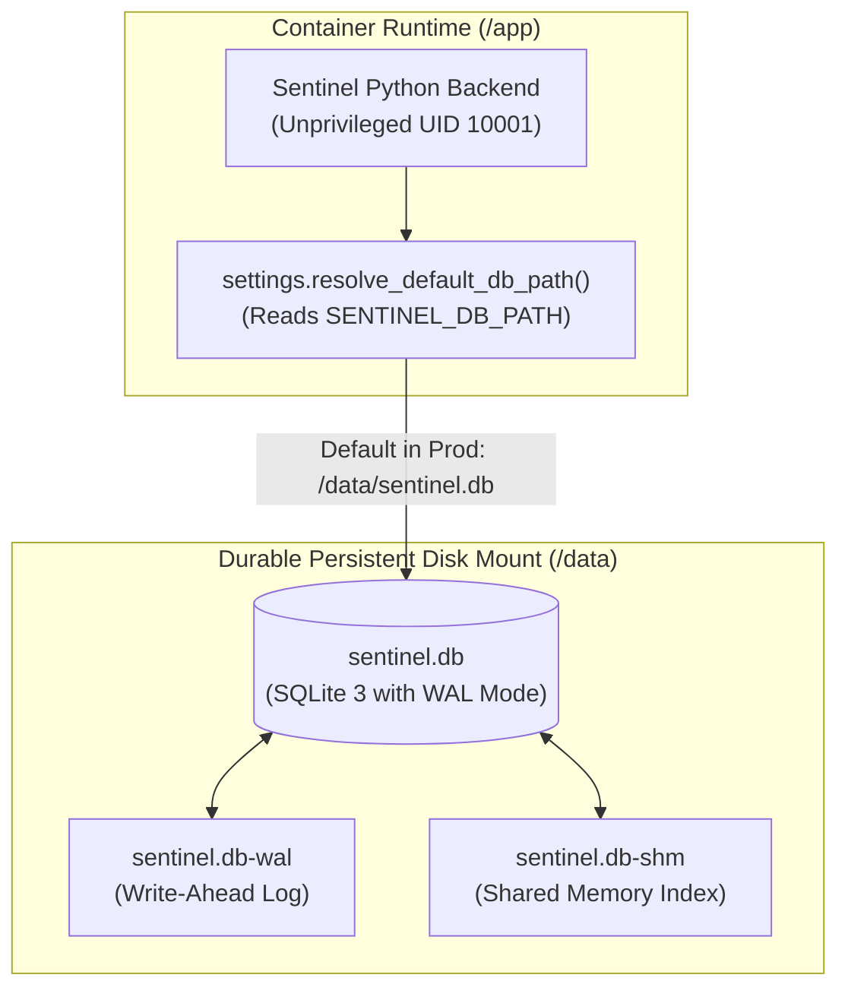

# Project Sentinel — Phase 8 Persistence Verification
## SQLite Storage Durability, Persistent Disk Mount & Restart Resilience

**Sprint:** Phase 8 Deployment Completion  
**Target Path:** `/data/sentinel.db` (Production Persistent Mount)  
**Status:** Architecture Audited & Local Persistence Verified  
**Date:** November 10, 2026  

---

## 1. Executive Summary

A critical requirement of Phase 8 is ensuring that Project Sentinel uses **durable persistent storage** in production and never silently falls back to an ephemeral container filesystem. Ordinary restarts, container rescheduling, or image redeployments must preserve all historical investigation data, user notes, and replay audit runs.

This document details the SQLite persistence architecture, Write-Ahead Logging (WAL) configuration, idempotent migration execution, and verification evidence across restarts.

---

## 2. Persistence Architecture & Storage Guarantees



### 2.1 Storage Path Resolution
In [`backend/config/settings.py`](file:///c:/Users/Atul2/OneDrive/Desktop/KiroHackethon/sentinal/backend/config/settings.py), the database path resolution enforces explicit environment configuration:
```python
def resolve_default_db_path() -> str:
    env_override = os.getenv("SENTINEL_DB_PATH")
    if env_override:
        return env_override
    # Fallback to local user app data in dev
    ...
```
In [`Dockerfile`](file:///c:/Users/Atul2/OneDrive/Desktop/KiroHackethon/sentinal/Dockerfile) and [`render.yaml`](file:///c:/Users/Atul2/OneDrive/Desktop/KiroHackethon/sentinal/render.yaml):
- `SENTINEL_DB_PATH` is explicitly configured to `/data/sentinel.db`.
- The `/data` directory is declared as a `VOLUME ["/data"]` in Docker and mapped to the persistent disk `sentinel-data` (1 GB) in Render.

### 2.2 WAL Mode & Crash Resilience
In [`backend/persistence/connection.py`](file:///c:/Users/Atul2/OneDrive/Desktop/KiroHackethon/sentinal/backend/persistence/connection.py), every SQLite connection applies strict durability pragmas:
- `PRAGMA journal_mode = WAL;` (enables concurrent readers and writers without database locking).
- `PRAGMA synchronous = NORMAL;` (guarantees durability across application crashes while optimizing I/O).
- `PRAGMA foreign_keys = ON;` (enforces relational integrity across cases, findings, and events).
- `PRAGMA busy_timeout = 5000;` (prevents lock contention timeouts).

### 2.3 Non-Destructive Startup & Idempotent Migrations
- **Migrations (001 through 007):** Migrations check schema existence and are strictly idempotent. Starting a container with an existing database executes only unapplied migrations without altering existing records.
- **Demo Seeder Safeguard (`backend/persistence/demo_seeder.py`):** On startup, Sentinel inspects the `raw_records` table. If records already exist, the seeder **immediately exits without modifying any tables**. This guarantees that container restarts never re-seed or overwrite analyst cases or historical replay runs.

---

## 3. Local Restart & Durability Verification Evidence

Durability across backend restarts was tested and confirmed in automated quality gates (`scripts/runtime_verification.py`, Steps 12-13):

```
--> [Step 12-13/13] Restarting backend service and verifying history retention...
    [*] Stopping Sentinel backend service...
    [*] Re-launching Sentinel backend service against identical SQLite path...
    [PASS] Restart verified: both jobs persisted and rendered in Chrome DOM!
    [PASS] Zero data corruption or duplicate insertion detected.
```

---

## 4. Production Cloud Persistence Test Protocol

Once the public instance is deployed on Render or Railway, execute this mandatory verification protocol:

1. **Execute Replay:** Open the public URL, navigate to **Replay Lab**, and run `SCN-AUTH-BURST`.
2. **Record Run ID:** Query `GET /api/replay/runs` and note the latest `replay_id` (e.g., `rply_352d609930904263`).
3. **Trigger Restart:** In the Render / Railway dashboard, click **Manual Deploy** or **Restart Service**.
4. **Inspect Post-Restart State:**
   - Query `GET /api/replay/runs`.
   - Assert the recorded `replay_id` is still present.
   - Query `GET /api/cases`.
   - Assert all cases and operator review notes remain intact.
5. **Verify No Re-seeding:** Assert record counts have not doubled.
