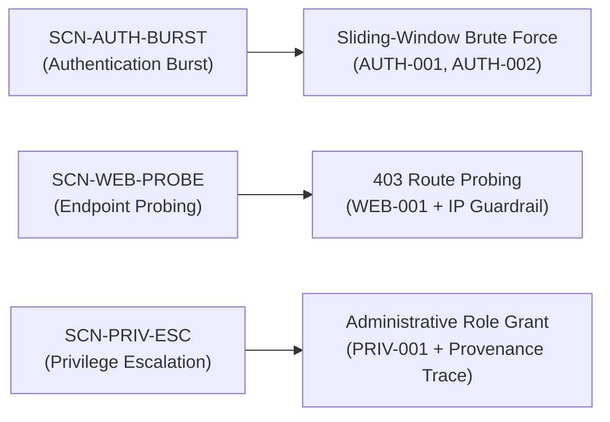

# Project Sentinel — Canonical Replay Scenarios Specification
## Authoritative Guide to Synthetic Incident Scenarios & Proof Assertions

**Sprint:** Phase 7  
**Status:** Approved & Verified  
**Date:** November 10, 2026  

---

## 1. Scenario Catalog Overview

Project Sentinel ships with three approved synthetic security incident scenarios. Each scenario is strictly deterministic, backed by an authentic committed fixture file with cryptographic SHA-256 checksums, and executes through the complete live Sentinel pipeline (`ImportEngine` -> `NormalizationEngine` -> `DetectionEngine` -> `CorrelationEngine` -> `ClaimGuardEngine`).

---

## 2. Scenario A: Suspicious Account Activity & Authentication Burst

- **Scenario ID:** `SCN-AUTH-BURST`
- **Category:** Authentication Security
- **Version:** `1.0.0`
- **Learning Objective:** Understand how deterministic sliding-window rules detect brute-force bursts (`AUTH-001`) and subsequent successful access (`AUTH-002`), how cases group on `user_principal`, and how Claim Guard blocks unproven attacker attributions.

### 2.1 Fixture Specification
- **Filename:** `fixtures/scenarios/scenario_a_auth_burst.csv`
- **SHA-256:** `45e53eda48ed3e2b683f3ce99bc25732de7e733e0b3a0f0fc323464283c13618`
- **File Size:** 383 bytes
- **Parser ID:** `auth_csv`
- **Record Count:** 6 records (5 failures, 1 success)

### 2.2 Chronological Events
| Line | Timestamp (UTC) | User Principal | Status | Source IP | Description |
| :---: | :--- | :--- | :--- | :--- | :--- |
| 2 | 2026-11-09T08:00:00Z | `operator_dave` | `FAILURE` | 198.51.100.10 | Initial authentication failure |
| 3 | 2026-11-09T08:01:00Z | `operator_dave` | `FAILURE` | 198.51.100.10 | Second authentication failure |
| 4 | 2026-11-09T08:02:00Z | `operator_dave` | `FAILURE` | 198.51.100.10 | Third authentication failure |
| 5 | 2026-11-09T08:03:00Z | `operator_dave` | `FAILURE` | 198.51.100.10 | Fourth authentication failure |
| 6 | 2026-11-09T08:04:00Z | `operator_dave` | `FAILURE` | 198.51.100.10 | Fifth failure — triggers `AUTH-001` |
| 7 | 2026-11-09T08:10:00Z | `operator_dave` | `SUCCESS` | 198.51.100.10 | Successful login within window — triggers `AUTH-002` |

### 2.3 Expected Pipeline Outputs
- **Imported Records:** 6
- **Normalized Events:** 6
- **Triggered Rules:** `AUTH-001` (Medium), `AUTH-002` (High)
- **Findings Count:** 2
- **Correlated Cases:** 1 (Severity: `High`, Correlation Key: `user_principal:operator_dave`)
- **Claim Guard Verifications:**
  - `clm_scn_a_01`: `verified` (Exact 5 failure count verified)
  - `clm_scn_a_02`: `verified` (`AUTH-002` High severity finding verified)
  - `clm_scn_a_03`: `blocked` (Fabricated claim attributing login to `attacker_eve` BLOCKED)
  - `clm_scn_a_04`: `qualified` (Inferred correlation relationship qualified with confidence caveat)

### 2.4 Supported What-If Configurations
- `WIF-THRESHOLD-10`: Increase `AUTH-001` failure threshold from 5 to 10. (Suppresses `AUTH-001`, leaving only 1 finding).

---

## 3. Scenario B: Sensitive Endpoint Probing & Route Scanning

- **Scenario ID:** `SCN-WEB-PROBE`
- **Category:** Web Application Security
- **Version:** `1.0.0`
- **Learning Objective:** Observe route normalization, distinguish 403 Forbidden status codes (`WEB-001`), and verify strict enforcement of Sentinel's IP Guardrail (cannot infer human user identity from network IP alone).

### 3.1 Fixture Specification
- **Filename:** `fixtures/scenarios/scenario_b_web_probe.csv`
- **SHA-256:** `c76e17ccf0b6e21a779a55d4414982f799a2b8b15603c568bc48c743b74be463`
- **File Size:** 448 bytes
- **Parser ID:** `web_csv`
- **Record Count:** 5 records (3 HTTP 403 Forbidden probes, 2 HTTP 200 OK)

### 3.2 Chronological Events
| Line | Timestamp (UTC) | Method | Request Path | Status | Source IP | User Agent |
| :---: | :--- | :--- | :--- | :--- | :--- | :--- |
| 2 | 2026-11-09T08:00:00Z | GET | `/index.html` | 200 | 203.0.113.88 | Mozilla/5.0 |
| 3 | 2026-11-09T08:02:00Z | GET | `/admin` | 403 | 203.0.113.88 | curl/8.4.0 |
| 4 | 2026-11-09T08:04:00Z | POST | `/api/v1/auth` | 403 | 203.0.113.88 | curl/8.4.0 |
| 5 | 2026-11-09T08:06:00Z | GET | `/config` | 403 | 203.0.113.88 | curl/8.4.0 |
| 6 | 2026-11-09T08:12:00Z | GET | `/about` | 200 | 203.0.113.88 | Mozilla/5.0 |

### 3.3 Expected Pipeline Outputs
- **Imported Records:** 5
- **Normalized Events:** 5
- **Triggered Rules:** `WEB-001` (Medium, sensitive endpoint 403 burst >= 3 within 10 min)
- **Findings Count:** 1
- **Correlated Cases:** 1 (Severity: `Medium`, Correlation Key: `source_ip:203.0.113.88`)
- **Claim Guard Verifications:**
  - `clm_scn_b_01`: `verified` (3 HTTP 403 events verified)
  - `clm_scn_b_02`: `verified` (`WEB-001` finding verified)
  - `clm_scn_b_03`: `blocked` (**IP Guardrail Block:** AI claim attempting to identify user as `suspect_ip_user` based solely on IP 203.0.113.88 is BLOCKED)

---

## 4. Scenario C: Privilege Escalation & Audit Log Investigation

- **Scenario ID:** `SCN-PRIV-ESC`
- **Category:** Identity & Access Governance
- **Version:** `1.0.0`
- **Learning Objective:** Verify role-change detection (`PRIV-001`), trace immutable SHA-256 provenance hashes back to original audit logs, and observe Claim Guard blocking exaggerated record counts.

### 4.1 Fixture Specification
- **Filename:** `fixtures/scenarios/scenario_c_priv_esc.jsonl`
- **SHA-256:** `f4ffffdb030c764bf938464bba8748ad62fbf8e825ce59f7fb2972ab98163066`
- **File Size:** 580 bytes
- **Parser ID:** `audit_jsonl`
- **Record Count:** 3 records (1 role change, 2 standard operations)

### 4.2 Chronological Events
| Line | Timestamp (UTC) | Event Type | Actor | Target User | Role Granted | Status |
| :---: | :--- | :--- | :--- | :--- | :--- | :--- |
| 1 | 2026-11-09T08:01:00Z | `user_login` | `analyst_bob` | `analyst_bob` | — | SUCCESS |
| 2 | 2026-11-09T08:05:00Z | `role_changed` | `admin_carol` | `analyst_bob` | `security_admin` | SUCCESS |
| 3 | 2026-11-09T08:12:00Z | `data_export` | `analyst_bob` | `analyst_bob` | — | SUCCESS |

### 4.3 Expected Pipeline Outputs
- **Imported Records:** 3
- **Normalized Events:** 3
- **Triggered Rules:** `PRIV-001` (High, role change event detected)
- **Findings Count:** 1
- **Correlated Cases:** 1 (Severity: `High`, Correlation Key: `user_principal:analyst_bob`)
- **Claim Guard Verifications:**
  - `clm_scn_c_01`: `verified` (Target user `analyst_bob` confirmed)
  - `clm_scn_c_02`: `verified` (`PRIV-001` finding confirmed)
  - `clm_scn_c_03`: `blocked` (**Fabricated Count Block:** AI hallucination claiming 50 role-change events when only 1 occurred is BLOCKED)
  - `clm_scn_c_04`: `qualified` (Time window duration qualified)

### 4.4 Supported What-If Configurations
- `WIF-EXCLUDE-ROLE-CHANGE`: Exclude line 2 (the `role_changed` event) to verify causal dependency. (Result: 0 findings, 0 cases).

