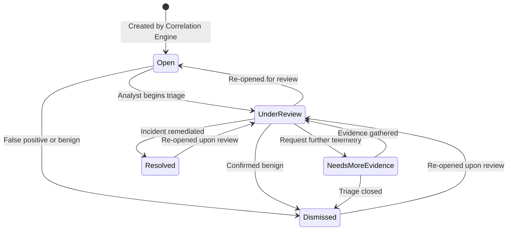

# Investigation Cases Documentation
**Project Sentinel — Security Operations Platform**

---

## 1. Overview

In Project Sentinel, an **Investigation Case** represents a unified incident container that groups related security findings and canonical events sharing an explicit identity within a bounded time window.

Cases provide security analysts with an evidence-backed narrative rather than a disjointed list of individual alerts. Every case provides:
- A transparent reason for why events were clustered (**Correlation Rationale**).
- A derived severity score calculated directly from its highest constituent finding (**Derived Severity**).
- A complete, chronological reconstruction of events, findings, and operator actions (**Evidence Timeline**).
- An immutable, append-only audit trail of analyst decisions and notes (**Review Actions**).

---

## 2. Case Lifecycle & State Machine

Cases transition through a strictly enforced state machine:



### Allowed Transitions:
| From Status | Permitted Target Statuses | Description |
| :--- | :--- | :--- |
| **`Open`** | `UnderReview`, `Dismissed` | Unassigned case awaiting initial analyst assessment. |
| **`UnderReview`** | `NeedsMoreEvidence`, `Resolved`, `Dismissed`, `Open` | Active analyst investigation in progress. |
| **`NeedsMoreEvidence`** | `UnderReview`, `Dismissed` | Blocked on additional log imports or external context. |
| **`Resolved`** | `UnderReview` | Successfully remediated security incident. |
| **`Dismissed`** | `UnderReview` | Assessed as benign, authorized testing, or false positive. |

Direct illegal transitions (e.g. `Open` $\rightarrow$ `Resolved`) are rejected with an explicit validation error.

---

## 3. Case Anatomy & Data Structure

```json
{
  "case_id": "case_649ad5f8c70875775091",
  "title": "Suspicious Activity Correlated for User 'analyst_bob'",
  "description": "Correlated 3 security finding(s) under user_principal 'analyst_bob' within 3600 seconds.",
  "status": "UnderReview",
  "severity": "High",
  "correlation_key_type": "user_principal",
  "correlation_key_value": "analyst_bob",
  "first_observed_at": "2026-11-09T10:00:00Z",
  "last_observed_at": "2026-11-09T10:20:00Z",
  "algorithm_version": "1.0.0",
  "dedupe_key": "user_principal:analyst_bob:498322",
  "metadata": {
    "window_seconds": 3600,
    "derived_from_count": 3,
    "max_finding_severity": "High",
    "severity_derivation": "Derived as 'High' because the highest severity constituent finding is 'High'.",
    "correlation_rationale": "Grouped 3 finding(s) and 7 event(s) sharing user_principal 'analyst_bob' within 3600s observation window. Source IP was not used to establish identity.",
    "rule_ids": ["AUTH-001", "AUTH-002", "PRIV-001"]
  },
  "finding_count": 3,
  "event_count": 7,
  "review_count": 2,
  "created_at": "2026-11-09T21:30:00Z",
  "updated_at": "2026-11-09T21:35:00Z"
}
```

---

## 4. Derived Severity Calculation

Case severity is strictly deterministic and derived directly from the maximum severity among constituent findings:

$$\text{Severity}(\text{Case}) = \max_{f \in \text{Findings}} \text{Severity}(f)$$

Severity Rank:
$$\text{Critical (5)} > \text{High (4)} > \text{Medium (3)} > \text{Low (2)} > \text{Info (1)}$$

If an initial correlation groups `AUTH-001` (Medium) and subsequent logs generate `PRIV-001` (High), the case severity automatically elevates to `High`. The rationale explicitly states which rule drove the severity.

---

## 5. Review Actions & Audit Logging

Every operator interaction with a case is recorded in the append-only `review_actions` table:
- **`status_changed`**: Captures `previous_status`, `new_status`, `operator_note`, and `author`.
- **`note_added`**: Records analyst commentary and investigation milestones without altering status.

Review actions cannot be edited or deleted, ensuring a permanent audit trail for incident response compliance.

---

## 6. REST API Reference

### `GET /api/cases`
Query investigation cases with filtering and pagination.
- **Query Parameters**:
  - `status`: Filter by status (`Open`, `UnderReview`, `NeedsMoreEvidence`, `Resolved`, `Dismissed`).
  - `severity`: Filter by severity (`Critical`, `High`, `Medium`, `Low`, `Info`).
  - `key_type`: Filter by correlation key type (`user_principal`, `session_id`, `request_id`).
  - `search`: Free text search matching title or key value.
  - `limit`: Number of items per page (default 20, max 200).
  - `offset`: Pagination offset (default 0).

### `GET /api/cases/stats`
Returns total case counts and breakdowns by status and severity, alongside latest correlation run metrics.

### `GET /api/cases/{case_id}`
Returns complete case entity with:
- `findings`: Array of linked findings with full condition matches and limitations.
- `events`: Array of linked canonical events with file and line provenance.
- `timeline`: Assembled chronological timeline.
- `review_actions`: Complete operator review history.

### `POST /api/cases/correlate`
Triggers the deterministic correlation engine.
- **Request Body** (optional):
  ```json
  {
    "window_seconds": 3600,
    "limit_findings": 1000
  }
  ```

### `POST /api/cases/{case_id}/review`
Appends an operator note and/or updates case status.
- **Request Body**:
  ```json
  {
    "status": "UnderReview",
    "note": "Analyst investigating compromised API credentials.",
    "author": "analyst_alice"
  }
  ```

### `PATCH /api/cases/{case_id}`
Directly updates case status with validation.
- **Request Body**:
  ```json
  {
    "status": "Resolved"
  }
  ```

